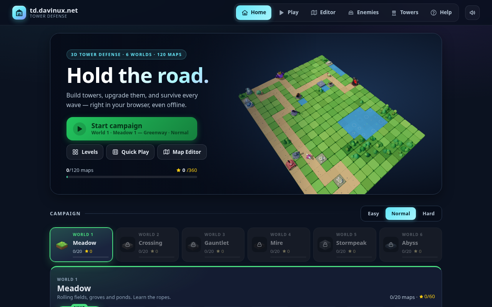
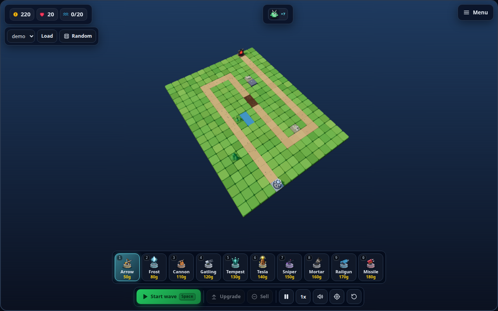
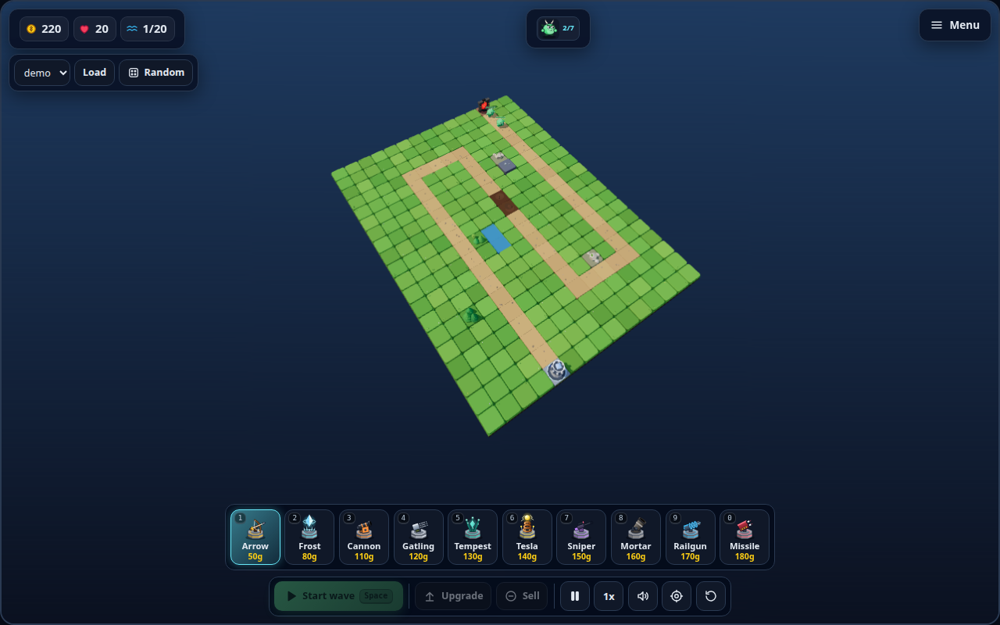
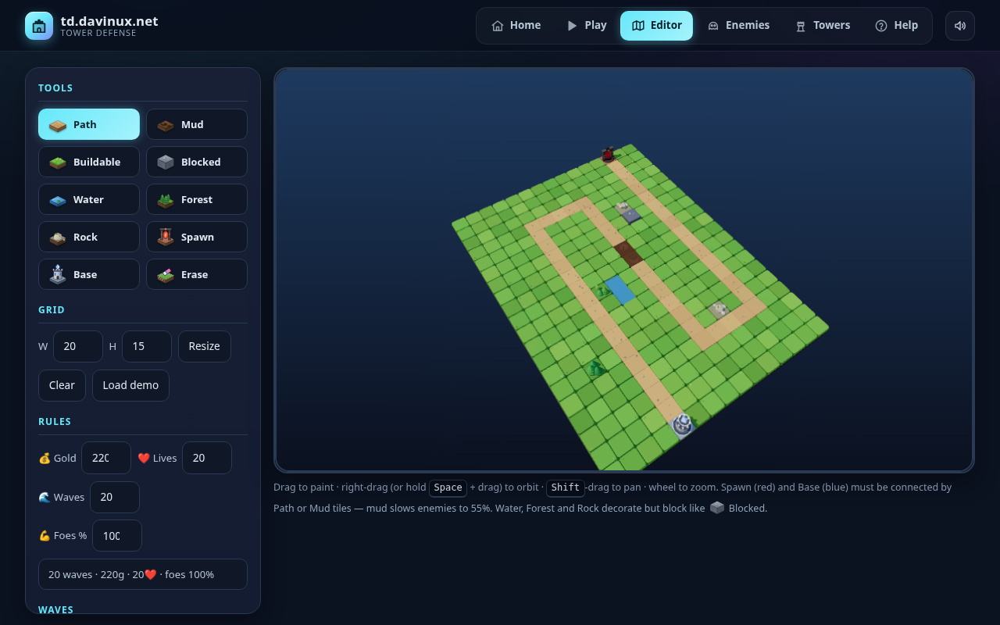
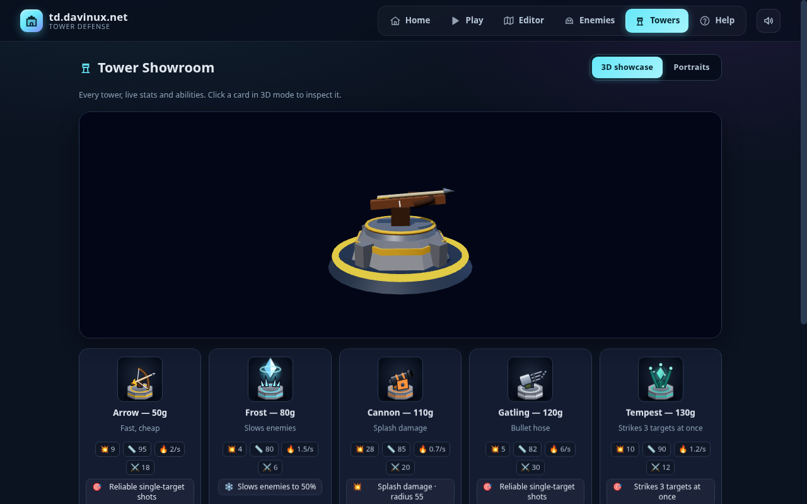
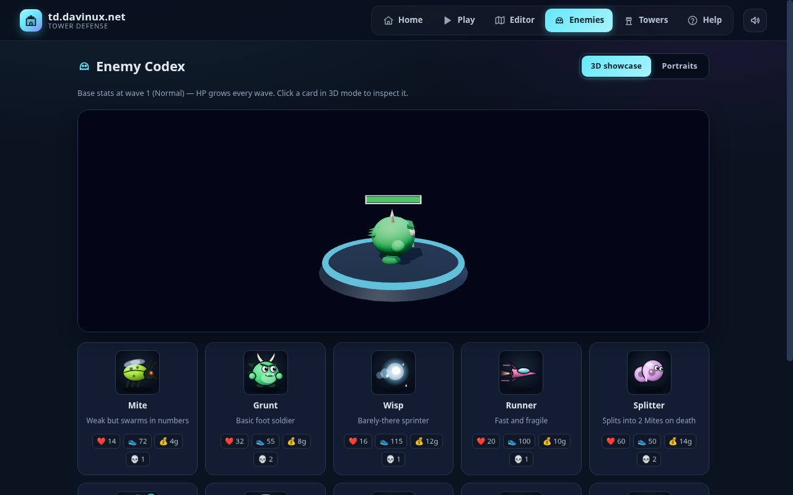

# td.davinux.net — Tower Defense

A browser tower-defense game with a 3D map editor, a 120-level campaign, and
full-3D rendering (Three.js, vendored locally). No build step, no dependencies
to install — just serve the folder statically.

Live at **https://td.davinux.net**.



## Screenshots

| Battle board (3D HUD, tower bar) | Wave in progress |
| --- | --- |
|  |  |

| Map editor | Tower showroom |
| --- | --- |
|  |  |

| Enemy codex |
| --- |
|  |

## How to play

### Goal

Enemies walk the brown road from the red **Spawn** to your blue **Base**.
Every enemy that arrives costs you ❤️ lives (2 for a Grunt, up to 10 for a
Warlord — see the table below). Lose all your lives and the run is over.
Survive every wave to win the map.

### Build

1. Pick a tower: click one in the bottom bar or press its hotkey (`1`–`9`, `0`).
2. Click a **green (buildable)** tile to place it. Hovering a tile previews the
   tower's range — green means it fits, red means blocked.
3. Towers cost gold (50g–180g). You start each sandbox run with **220g** and
   **20 lives**; campaign maps set their own economy per difficulty.

### Waves

- Press **Space** (or the *Start wave* button) to send the next wave. Nothing
  spawns until you do, so take your time to build between waves.
- Killing enemies pays gold per kill. Clearing a whole wave pays a bonus of
  **25g + 5g × wave number**.
- The badge at the top tracks wave progress (`1/20`) and how many enemies of
  the current wave have spawned.
- Campaign maps have **8–24 waves** (more on later maps and worlds). Sandbox
  runs default to 20 waves, then continue in **endless mode**.

### Upgrade and sell

- Click a placed tower, then **Upgrade** (`U`) or **Sell** (`X`). `Esc`
  deselects.
- Upgrade cost is **80% of the tower's base cost × its level**
  (e.g. upgrading a level-1 Arrow costs `50 × 0.8 × 1 = 40g`). Each level
  raises damage and range.
- Selling refunds **70%** of everything you spent on that tower.

### Tiles

| Tile | Effect |
| --- | --- |
| 🟤 Path | Enemies walk here. Connect Spawn to Base with it. |
| 🟫 Mud | Walkable road that slows enemies to **55%** speed — perfect kill-zone ground. |
| 🟩 Buildable | Towers can be built here. |
| ⬜ Blocked | Builds and walks nothing. |
| 🌊 Water · 🌲 Forest · 🪨 Rock | Decorative blockers: no building, no walking, just looks (block like ❌). |
| 🗼 Spawn / 💠 Base | Where enemies appear / what you defend. |

> **Tip:** Frost towers and mud stack — a Frost covering a mud stretch holds
> enemies in your splash zone almost twice as long. Phantoms are immune to all
> slowing, so keep raw damage ready for them.

### Campaign and difficulties

- **120 maps**: 6 worlds × 20 maps — Meadow, Crossing, Gauntlet, Mire,
  Stormpeak, Abyss — each with its own biome, enemy roster, and named maps.
- Roads get shorter, build room tighter, and waves tougher as you advance;
  enemy types unlock one at a time. Maps 10 and 20 (plus 5 and 15 from world 3
  on) end in **boss fights**.
- Each map is playable on **Easy / Normal / Hard**:

  | Difficulty | Gold | Lives | Enemy HP | Enemies |
  | --- | --- | --- | --- | --- |
  | Easy | +20% | +5 | ~0.8× | slightly fewer |
  | Normal | base | base | 1× | base |
  | Hard | −12% | −5 | 1.5× → 1.25× | slightly more |

- Finishing a map unlocks the next; finishing map 20 unlocks the next world.
  Your best difficulty per map is tracked with ★ ranks, saved in the browser.
- The Home tab offers one-click **Continue** (your next unfinished map), world
  tabs, and compact level tiles.

### Controls

| Key | Action |
| --- | ------ |
| `Space` / `Enter` | Start next wave |
| `1`–`9`, `0` | Select tower |
| `U` / `X` | Upgrade / sell selected tower |
| `P` / `F` / `R` | Pause / cycle speed (1x→2x→4x→8x) / restart |
| `M` | Mute / unmute |
| `G` | Generate random map (sandbox) |
| `C` | Recenter 3D camera |
| `Esc` | Deselect · open / close the pause menu · close dialog |

Mouse / touch in 3D: **drag** orbits, **right-drag** (or Shift-drag / two
fingers) pans, **wheel / pinch** zooms, **click** places and selects.
In the map editor, dragging paints tiles — hold **Space** while dragging to
orbit instead.

## Towers

All 10 towers, with base stats at level 1 (Normal). DPS ≈ damage × rate.

| # | Tower | Cost | Dmg | Rate | DPS | Range | Ability |
| --- | --- | --- | --- | --- | --- | --- | --- |
| `1` | Arrow | 50g | 9 | 2.0/s | 18 | 95 | Fast, cheap single-target |
| `2` | Frost | 80g | 4 | 1.5/s | 6 | 80 | Slows enemies to 50% for 1.6s |
| `3` | Cannon | 110g | 28 | 0.7/s | ~20 | 85 | Splash, radius 55 |
| `4` | Gatling | 120g | 5 | 6.0/s | 30 | 82 | Bullet hose |
| `5` | Tempest | 130g | 10 | 1.2/s | 12 | 90 | Strikes 3 targets at once |
| `6` | Tesla | 140g | 14 | 1.0/s | 14 | 95 | Chain lightning ×3 |
| `7` | Sniper | 150g | 55 | 0.55/s | ~30 | 175 | Long range, 20% crit ×2.5 |
| `8` | Mortar | 160g | 45 | 0.45/s | ~20 | 150 | Huge shells, splash 65, can't hit closer than 55 |
| `9` | Railgun | 170g | 30 | 0.8/s | 24 | 135 | Pierces every enemy in a line |
| `0` | Missile | 180g | 38 | 0.6/s | ~23 | 125 | Homing rockets, big splash 70 |

Browse them all live in the **Towers** tab (`#towers`), with a 3D showcase and
per-level stats — stats are data-driven from `data/towers.json`.

## Enemies

Base stats at wave 1 (Normal) — HP grows every wave. `Leak` is the lives lost
if one reaches your base.

| Enemy | HP | Speed | Reward | Leak | Tricks |
| --- | --- | --- | --- | --- | --- |
| Grunt | 32 | 55 | 8g | 2 | Basic foot soldier |
| Runner | 20 | 100 | 10g | 1 | Fast and fragile |
| Mite | 14 | 72 | 4g | 1 | Weak but swarms in numbers |
| Aegis | 95 | 46 | 15g | 2 | Energy-shielded |
| Wisp | 16 | 115 | 12g | 1 | Barely-there sprinter |
| Splitter | 60 | 50 | 14g | 2 | Splits into **2 Mites** on death |
| Bulwark | 150 | 34 | 22g | 3 | Slow, heavily armored |
| Phantom | 70 | 62 | 16g | 2 | **Immune to slow** |
| Golem | 320 | 30 | 30g | 4 | Walking avalanche |
| Warlord (boss) | 1300 | 28 | 150g | 10 | Huge HP, crushes lives |

Browse them all live in the **Enemies** tab (`#enemies`), with a 3D showcase
and portraits — stats are data-driven from `data/enemies.json`.

## Map editor

Paint your own battlefield, then jump straight in to test it:

- **Tools** — Path, Mud, Buildable, Blocked, Water, Forest, Rock, Spawn,
  Base, Erase. Spawn (red) and Base (blue) must be connected by Path or Mud.
- **Grid** — resize from 8×8 up to 30×20 (default 20×15), clear, or load the
  demo map.
- **Rules** — starting gold, lives, wave count, and enemy HP % (e.g.
  `20 waves · 220g · 20❤️ · foes 100%`).
- **Custom waves** — off by default (classic auto curve). Turn it on to edit
  every wave's enemy mix, or hit *Defaults* to restore the curve.
- **Save / Load / Delete** custom maps (persisted in localStorage),
  **Export / Import** them as JSON to share.
- **Validate & Play** — the editor checks your map and offers one-click
  *Test this map* in the Play view.

## More ways to play

- **Quick Play** — sandbox mode on your own maps or a procedurally generated
  random map (`G`), with endless waves past the final one.
- **Navigation** — every view has a URL hash (`#play`, `#editor`, `#enemies`,
  `#towers`, `#help`), so browser Back/Forward and deep links work; on phones
  the tabs become a bottom bar. In-game, *Menu* / `Esc` opens a pause menu
  (resume, restart, sound, level select, main menu).
- **Views** — everything plays in 3D (orbit / pan / zoom, fullscreen HUD with
  tower bar, wave preview, and inspector card). The main menu has an animated
  3D diorama backdrop. Canvas 2D remains only as an emergency fallback.
- **Sound** — procedural Web Audio SFX (shots, explosions, placements,
  upgrades, wave horns, victory/defeat stingers): zero assets, fully offline.
  Volume, mute, and on/off live in the header 🔊 settings (available before
  any game), the play sidebar, the 3D HUD, and the `M` hotkey — persisted in
  localStorage.
- **PWA** — installable (`manifest.json` + `sw.js`): the full 3D game works
  offline once visited, since Three.js is vendored in `vendor/`.

## Running it

The game loads its data files (`data/*.json`) and ES modules via `fetch`,
so it must be served over HTTP (opening `index.html` via `file://` will fail
to load the campaign — or use the single-file build in `tools/` instead).

```bash
./tools/start-server.sh          # serves on http://localhost:8000
./tools/start-server.sh 8080     # custom port
./tools/stop-server.sh           # stop it again
```

Then open the printed URL. Any static server works (`python3 -m http.server`,
`npx serve`, nginx, …) — there is no backend.

## Tools

All helper scripts live in `tools/`:

- `start-server.sh` / `stop-server.sh` — local static server (`[port]`,
  default 8000).
- `balance.mjs` — headless balance simulator: `node tools/balance.mjs`
  replays levels with a greedy bot player (same combat rules as the game) and
  prints win / lives per difficulty. Flags: `--all`, `--world <id>`,
  `--maps 1,5,20`, `--diffs hard`, `--verbose`. `--calibrate` measures each
  map's bot limit and prints the per-map `levelHp` multipliers that keep the
  difficulty curve smooth — re-run it (and paste into `campaign.json`) after
  changing maps, towers or enemies.
- `bundle-single-file.mjs` — builds a self-contained HTML file you can
  double-click (`file://`): `node tools/bundle-single-file.mjs`
  writes `dist/tfgame-standalone.html` (inlines all of `js/` + Three.js +
  data + CSS). `--keep-js` also writes `dist/bundle.js` for debugging,
  `--smoke` boots the bundle in Node with DOM stubs to catch linker errors.

## Tech stack

- **Vanilla JS (ES modules)** — `js/` holds one module per concern
  (`main.js` app shell, `game.js` simulation, `view3d.js` Three.js game view,
  `editor3d.js` Three.js map editor,
  `hud3d.js` 3D HUD, `art3d.js` shared materials + lighting rig (sun shadows, sky env map), `terrain3d.js` / `towers3d.js` / `enemies3d.js` 3D mesh builders + animation, `editor.js`, `levels.js` campaign/progress,
  `graphics.js` canvas vector art, `content.js` data loading, `model.js`
  tiles/pathfinding, `storage.js` persistence, `generator.js` random maps,
  `codex.js` / `showroom.js` catalogs, `tooltip.js` hover cards, `uiicons.js` SVG UI line icons,
  `audio.js` procedural sound, `menu3d.js` menu diorama). No framework, no bundler, no npm.
- **SVG icons** (`icons.js`) for towers, enemies and editor tiles — 3/4-view
  portraits matching the 3D models, crisp at any size, CSS-animated in the
  codex / showroom. Canvas 2D remains only as the emergency board fallback.
- **Three.js 0.160.0, vendored** in `vendor/` (no CDN, works offline) — game
  view, map editor, codex/showroom showcases, and menu diorama all share the
  same mesh builders.
- **Data-driven content** — `data/towers.json` and `data/enemies.json`
  define stats; `data/campaign.json` defines each world's biome (road length
  and straightness, water/forest/rock/cliff shares, canyon walls, mud),
  enemy weights, economy, toughness curve and map names. `js/mapgen.js`
  builds every map from that theme with a fixed seed (lattice road that can
  never shortcut itself + clumpy noise terrain), so maps are identical on
  every load; Quick Play's random maps use the same generator.
- **Persistence** — campaign progress, view preference, and custom maps live
  in `localStorage`; no account or server state.
- **PWA** — `manifest.json`, generated PNG icons in `icons/`, and a
  cache-first service worker (`sw.js`).

## Project layout

```
index.html          app shell + all views (menu, codex, showroom, editor, play, help)
style.css           full UI theme (single stylesheet)
manifest.json       PWA manifest
sw.js               offline service worker
icons/              PWA / touch icons
vendor/             vendored Three.js (offline-capable 3D)
js/                 ES modules (see Tech stack)
data/               towers, enemies, campaign worlds (*.json)
docs/screenshots/   README screenshots (headless-Chromium captures)
tools/              dev scripts and simulators:
                      start-server.sh / stop-server.sh (local static server),
                      balance.mjs (balance simulator),
                      bundle-single-file.mjs (single-file offline build → dist/)
```

## Notes for contributors

- Keep the game dependency-free: no build step means any change is live on
  reload.
- Gameplay-affecting numbers belong in `data/*.json`, not in code. If you
  change them, update the Towers / Enemies tables above to match.
- Screenshots in `docs/screenshots/` were captured with headless Chromium
  (`--enable-unsafe-swiftshader`, 1280×800) against a local server; re-take
  them the same way after visual changes.
- The 2D canvas is an emergency fallback only: all player-facing rendering
  is 3D. The 3D scenes read live state via the `game`/editor APIs.
- The HUD mirrors the sidebar by calling the same `game` methods — add new
  player actions there once and wire both UIs to them.
